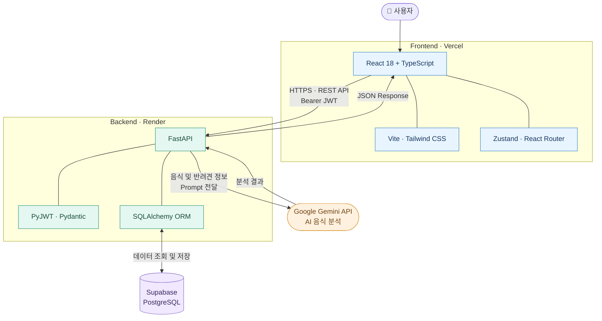

# 🐶 WhatCanDogsEat

<h3 align="center">🐾 우리 강아지, 이 음식 먹어도 될까?</h3>

<p align="center">
  <strong>반려견의 건강 정보를 기반으로 음식 급여 가능 여부를 분석하는 AI 서비스</strong>
  <br />
  반려견의 개별 건강 정보와 음식 정보를 바탕으로 AI가 급여 시 주의사항을 분석합니다.
</p>

<p align="center">
  <a href="https://whatcandogseat-frontend.vercel.app">
    <strong>🚀 서비스 바로가기</strong>
  </a>
</p>

<p align="center">
  
  
  
  
  
  
</p>

---

## 📌 프로젝트 소개

**WhatCanDogsEat**은 반려견의 건강 정보를 바탕으로 음식의 급여 안전성을 분석하는 AI 기반 웹 서비스입니다.

사용자가 반려견의 프로필을 등록하고 음식을 검색하면, 선택한 반려견의 정보와 음식 이름을 Gemini API에 전달하여 급여 가능 여부와 주의사항을 확인할 수 있습니다.

### ✨ 주요 기능

- 🔐 **회원가입 및 로그인** — JWT 기반 사용자 인증
- 🐕 **반려견 관리** — 사용자별 반려견 등록 및 정보 관리
- 🍎 **AI 음식 분석** — Gemini API를 활용한 음식 안전성 분석
- 🩺 **개인화된 분석** — 반려견의 알러지 및 건강 정보를 프롬프트에 반영
- 🎨 **직관적인 UI** — 검색 결과를 쉽게 확인할 수 있는 사용자 인터페이스

## 📅 프로젝트 정보

| 항목 | 내용 |
|:---|:---|
| 개발 기간 | 2026.09 ~ 2026.10 |
| 개발 인원 | 1명 |
| 개발 형태 | 개인 프로젝트 |
| Frontend | React 18, TypeScript, Vite, Zustand, React Router |
| Backend | Python, FastAPI, Uvicorn, Pydantic, PyJWT |
| Database | Supabase PostgreSQL, SQLAlchemy |
| AI | Google Gemini API |
| Deployment | Vercel, Render, Supabase |

## 🛠 기술 스택

### 🎨 Frontend

| 기술 | 설명 |
|:---|:---|
| **React 18** | 컴포넌트 기반 UI 구현 |
| **TypeScript** | 정적 타입 검사 및 타입 안정성 확보 |
| **Vite** | 프론트엔드 개발 및 빌드 환경 구성 |
| **Zustand** | 로그인 상태 및 반려견 목록 등 전역 상태 관리 |
| **React Router** | 페이지 라우팅 및 화면 전환 |
| **Tailwind CSS** | 유틸리티 클래스 기반 UI 스타일링 |

### ⚙️ Backend

| 기술 | 설명 |
|:---|:---|
| **Python** | 백엔드 개발 언어 |
| **FastAPI** | REST API 서버 구현 |
| **Uvicorn** | ASGI 서버 실행 |
| **Pydantic** | 요청 및 응답 데이터 검증 |
| **PyJWT** | JWT 기반 사용자 인증 |
| **SQLAlchemy** | ORM 기반 데이터 접근 및 관리 |

### 🗄️ Database & AI

| 기술 | 설명 |
|:---|:---|
| **Supabase PostgreSQL** | 배포 환경의 관계형 데이터베이스 |
| **Google Gemini API** | 생성형 AI 기반 음식 안전성 분석 |
| **Prompt Engineering** | 반려견의 건강 정보와 음식 정보를 고려한 분석 프롬프트 설계 |

### ☁️ Deployment

| 서비스 | 역할 |
|:---|:---|
| **Vercel** | 프론트엔드 배포 |
| **Render** | FastAPI 백엔드 배포 |
| **Supabase** | PostgreSQL 데이터베이스 제공 |

## 🏗️ 시스템 아키텍처



### 🔄 데이터 처리 흐름

1. **서비스 접속:** 사용자가 Vercel에 배포된 웹 서비스에 접속합니다.
2. **API 요청:** 프론트엔드에서 Render의 FastAPI 서버로 HTTPS 기반 REST API 요청을 보냅니다.
3. **사용자 인증:** 인증이 필요한 요청은 JWT를 전달하며, 백엔드에서 토큰을 검증합니다.
4. **데이터 조회:** SQLAlchemy ORM을 통해 Supabase PostgreSQL에서 사용자 및 반려견 정보를 조회합니다.
5. **AI 분석 요청:** 음식 이름과 선택한 반려견의 관련 정보를 조합해 Gemini API에 전달합니다.
6. **결과 반환:** AI 분석 결과를 백엔드에서 JSON 형태로 반환하고 프론트엔드에서 표시합니다.

## 💡 주요 구현 내용

### 1. 🔐 JWT 기반 사용자 인증

사용자 인증 및 API 접근 제어를 위해 JWT 기반 인증 방식을 적용했습니다.

- 로그인 후 인증 토큰 발급
- 프론트엔드에서 토큰 관리
- API 요청 시 `Authorization: Bearer <token>` 헤더 전달
- 백엔드에서 토큰을 검증하고 사용자 정보 확인

> **핵심 포인트:** 인증 정보를 기반으로 사용자별 데이터를 구분하고, 보호된 API 요청을 처리하도록 구현했습니다.

### 2. 🐕 사용자별 반려견 데이터 관리

사용자와 반려견의 관계를 **1:N 구조**로 설계했습니다.

- 사용자별 여러 마리의 반려견 관리
- 반려견의 나이, 견종, 알러지 및 건강상태 관리
- 선택한 반려견의 정보를 음식 분석 요청에 활용

> **핵심 포인트:** 로그인 사용자뿐 아니라 현재 분석 대상으로 선택한 반려견을 구분해 개인화된 분석 요청을 구성했습니다.

### 3. 🤖 Gemini API 연동

FastAPI에서 Gemini API를 호출해 음식의 급여 안전성을 분석하도록 구현했습니다.

- 검색한 음식 이름 전달
- 반려견의 개별 건강 정보 반영
- 급여 가능 여부 및 판단 근거 생성
- 프론트엔드에서 활용할 수 있는 JSON 응답 구조 설계

**응답 데이터 예시**

```json
{
  "food": "고구마",
  "is_safe": true,
  "description": "급여 시 주의사항과 판단 근거"
}
```

> **핵심 포인트:** 단순한 AI API 호출을 넘어 사용자별 데이터를 프롬프트에 반영하고, 서비스에서 처리할 수 있는 형태로 결과를 구성했습니다.

### 4. 🎨 프론트엔드 상태 관리

React 기반의 화면 구성과 전역 상태 관리를 구현했습니다.

- **Zustand:** 로그인 상태 및 반려견 목록 등 공유 상태 관리
- **React Router:** 홈, 로그인, 회원가입 페이지 라우팅
- **TypeScript:** 데이터 타입을 명시해 코드 안정성 확보
- **Tailwind CSS:** UI 스타일링 및 일관된 화면 구성

## 🚀 배포 환경

각 구성 요소를 역할에 따라 분리해 배포했습니다.

| 구성 요소 | 배포 서비스 | 담당 역할 |
|:---|:---|:---|
| Frontend | Vercel | 웹 UI 제공 |
| Backend | Render | API 처리 및 AI 연동 |
| Database | Supabase | 사용자 및 반려견 데이터 저장 |

🔗 **배포 서비스:** [WhatCanDogsEat 바로가기](https://whatcandogseat-frontend.vercel.app)


---

<p align="center">
  <strong>🐶 WhatCanDogsEat</strong>
  <br />
  우리 강아지에게 더 안전한 식탁을 위해 🐾
  <br /><br />
  <a href="https://whatcandogseat-frontend.vercel.app">🌐 Live Demo</a>
</p>
